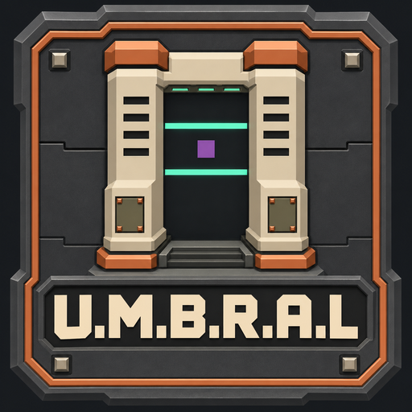
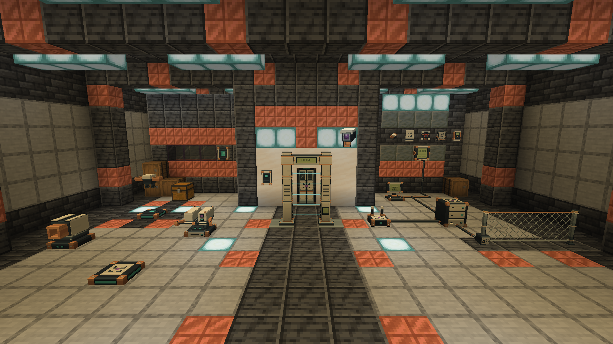
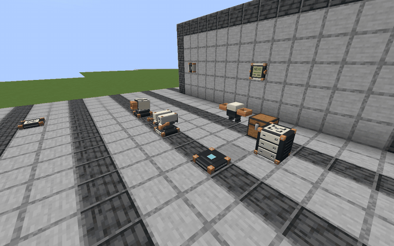

# UMBRAL Base Security

UMBRAL is a Fabric mod for securing a Minecraft base. Give your friends keycards, check the live feed from a VIGÍA camera, and use FILTRO to inspect what visitors carry through an entrance. MOTA can bring ammunition from a chest you authorize to a turret that needs it.

UMBRAL means “threshold” in Spanish. The badge spells out the initials of **Unidad Modular de Barreras, Redstone, Acceso y Logística**.

## Play

UMBRAL 1.6.1 is a beta for Minecraft Java 26.3. Install it with Java 25, Fabric Loader 0.20.1 or newer, and Fabric API for Minecraft 26.3. Install the mod and Fabric API on the client and server. [CurseForge project](https://www.curseforge.com/minecraft/mc-mods/umbral-base-security)

Open the UMBRAL Field Manual in game to set up your first door, card reader, or protected room. The manual and menus are available in English and Spanish.

## Build and report bugs

Install JDK 25, then run `./gradlew build` on Linux or macOS, or `gradlew.bat build` on Windows. Gradle puts the JAR in `build/libs`.

For a bug report, include your Minecraft, Fabric Loader, Fabric API, and UMBRAL versions, and the steps that reproduce the problem. AI tools assisted development and visual design. The screenshots and GIF show Minecraft gameplay.

## License

The original code uses MPL-2.0. The original artwork and branding have separate terms. [Code license](LICENSE) · [License scope](LICENSE-SCOPE.md) · [Artwork terms](ASSET-LICENSE.md) · [Third-party notices](THIRD_PARTY_NOTICES.md)

## Support

UMBRAL is free to download and play. If you'd like to help fund future updates, you can leave a voluntary donation. [Support ReyMidas on Ko-fi](https://ko-fi.com/rey_midas)

UMBRAL is an unofficial Minecraft mod, independent of Mojang and Microsoft.
